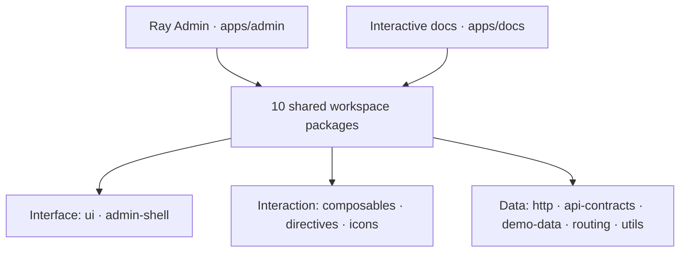

# Ray Template

**Four visual styles. Five navigation layouts. A Vue 3 workspace you can make your own.**

[简体中文](README.zh-CN.md) · **[Live demo](https://xiaodaigua-ray.github.io/ray-template/)** · **[Documentation](https://xiaodaigua-ray.github.io/ray-template/docs/)** · [Quick start](#quick-start) · [Architecture](#one-workspace-shared-building-blocks)

Ray Template is an open-source frontend template for admin dashboards, operations consoles, and internal tools. It brings together a working application, reusable packages, and interactive documentation. Start with the demo, choose a look, and connect your business APIs.

**4 visual styles · 5 navigation layouts · 11 TablePro examples · 10 shared packages**

[](https://xiaodaigua-ray.github.io/ray-template/#/dashboard)

[](https://xiaodaigua-ray.github.io/ray-template/#/tables/auto-height)

_Welcome page and TablePro · Default Modern style · Light mode._

## Choose your look and layout

### Four styles across the interface

| Style        | Character                                                                |
| ------------ | ------------------------------------------------------------------------ |
| **Modern**   | Blue accents, balanced spacing, and soft corners. The default workspace. |
| **Naive UI** | Native controls, familiar proportions, and green accents.                |
| **Material** | Tonal surfaces, larger corners, and capsule-shaped buttons.              |
| **Plain**    | Neutral colors, compact corners, and flat surfaces.                      |

Styles cover the shell, controls, tables, and chart themes. Each supports light and dark modes; follow the system or choose a mode yourself. Customize the primary color and export or import your preferences as JSON.


[](https://xiaodaigua-ray.github.io/ray-template/#/tables/auto-height)

_The same welcome page and TablePro in Modern dark mode._

### Five ways to organize the workspace

**Side · Top · Mixed · Right · Split**

Keep navigation in a sidebar, move it to the top or right, or separate top-level groups from their child menus. Choose fluid or centered content, adjust spacing, and pin the header or footer. Narrow screens use a menu drawer.

Page tabs, KeepAlive, breadcrumbs, `⌘/Ctrl + K` search, content maximization, page transitions, and English / Simplified Chinese are built in. Layout, appearance, and menu preferences update live and persist in the browser.

[Appearance and theme tokens](apps/docs/guide/appearance.md) · [Layout playground](apps/docs/guide/layout.md) · [Shell integration](apps/admin/src/layout/README.md)

## TablePro, ready for business workflows

Use `RTablePro` for a plain table, a searchable directory, or a dense operations page. Column definitions and custom cells follow Naive UI DataTable.

- **Search that grows with the page.** Text, numbers, multiple selection, dates, trees, cascades, and custom fields; validation, dependent remote options, and manual or debounced submission.
- **Local and remote data.** Local filtering, component-managed requests, or pagination controlled by the page. Remote queries accept only the latest result and forward cancellation signals.
- **A usable data workspace.** Automatic height, virtual scrolling, column visibility, reordering, pinning, and stored column preferences.
- **Everyday tools.** Copy the table as a PNG, export CSV, print a table or custom region, and add row menus or toolbar actions.
- **Control from your page.** `useTablePro` exposes search, pagination, current-page data, and request state. Selection stays in the page's controlled row keys.

Failed queries clear the failed result and report the error; users can query again or reload. The examples cover success, cancellation, and failure recovery.

Explore [11 runnable examples](https://xiaodaigua-ray.github.io/ray-template/docs/reference/table-pro-examples.html), including advanced search, controlled pagination, column settings, printing, and instance hooks. Each includes the source that actually runs.

[TablePro API](apps/docs/reference/table-pro.md) · [Component contract](packages/ui/src/RTablePro/README.md) · [First business page](apps/docs/guide/first-page.md)

## A working application to build on

| Area                        | Included                                                                                                                       |
| --------------------------- | ------------------------------------------------------------------------------------------------------------------------------ |
| **Users and organizations** | Organization tree, member search, create/edit/detail flows, account status, roles, and permission-aware actions.               |
| **Routes and permissions**  | Visual and JSON route editors, menu generation, role-based navigation, direct-route guards, and page caching.                  |
| **Forms and dialogs**       | `RForm`, `useForm`, and `RModal` with validation, reset, loading, and runnable examples.                                       |
| **Charts and interaction**  | ECharts lifecycle and theme handling, LogicFlow, draggable cards, context menus, screenshots, printing, and fullscreen.        |
| **Icons and utilities**     | Typed SVG names and generated sprites, QR codes, barcodes, precision arithmetic, storage helpers, composables, and directives. |
| **Documentation**           | Guides, API references, and interactive examples using the same workspace packages as the application.                         |

The demo uses **MSW HTTP mocks** for login, users, routes, and example data, both in development and on the static hosted site. To connect a backend, set `VITE_API_BASE_URL` and `VITE_API_MOCK=false`. Shared schemas and generated **OpenAPI 3.1** describe the contract; your backend owns real sessions and API authorization.

[Backend integration](apps/docs/guide/backend.md) · [Routing guide](apps/admin/src/router/README.md) · [Components](apps/docs/reference/components.md) · [Composables](apps/docs/reference/hooks.md)

## One workspace, shared building blocks

Ray Admin and the documentation live in one **pnpm monorepo**. Business integration stays in the application; reusable capabilities have explicit package entry points.



- **[apps/admin](apps/admin)** owns pages, sessions, Pinia, route registration, API integration, and mocks.
- **[apps/docs](apps/docs)** runs shared components and embeds application examples from the same build.
- **[packages](packages)** exposes public `exports`; boundary checks validate imports, declared dependencies, and cycles. These are workspace packages, not separately published npm packages.

Semantic theme tokens let custom pages follow the selected style, mode, and primary color. The shell exposes runtime layout dimensions and slots for the header, sidebar, tabs, footer, and content.

[Architecture map](docs/architecture.md) · [API contracts](packages/api-contracts/README.md) · [Custom CSS contract](docs/ui-design.md#custom-css-contract)

## Quick start

Use **Node.js 26.13.0** and **pnpm 12.16.1**, as pinned in the repository.

```sh
git clone https://github.com/XiaoDaiGua-Ray/ray-template.git
cd ray-template
nvm install
nvm use
npm install --global pnpm@12.16.1
pnpm install --frozen-lockfile
pnpm dev
```

Open [http://127.0.0.1:9527/ray-template/](http://127.0.0.1:9527/ray-template/) and click **Continue with demo account**. The login page also offers manager and read-only accounts. No business backend is needed to explore the demo.

1. **Try the interface.** Open Settings to change styles and layouts, then explore Users and TablePro.
2. **Build a page.** Start with an [existing example](apps/admin/src/views/demo), register its view ID, and add a route with bilingual menu labels.
3. **Connect your API.** Keep the page contract and connect your backend using the [integration guide](apps/docs/guide/backend.md).

## Choose a source distribution

The frontend distribution contains Admin, documentation, shared packages, and Mock. It installs and runs independently without a database or Redis. Run `pnpm dist:frontend` to produce `ray-template-frontend-<version>.tar.gz` and its source directory under `dist/distributions/`. Extract it, then run `pnpm install --frozen-lockfile` and `pnpm dev`.

Each artifact includes `distribution.json` with its version, source commit and workspace state, workspace list, and content digest. Export prunes the lockfile, dependencies, commands, and fullstack-only documentation, and excludes local configuration, credentials, build output, and installed dependencies. See [distributions and startup](apps/docs/guide/distributions.md).

<!-- fullstack:start -->

The complete source also includes an optional [NestJS server](apps/server). PostgreSQL stores users, permissions, sessions, route configuration, and audits; Redis provides rate limits and cache for demonstration reads. Run `pnpm dist:fullstack` to export the matching fullstack source archive.

After installing dependencies, prepare Docker Compose and run:

```sh
pnpm fullstack:setup
pnpm dev:full
```

To build and start the entire stack in Docker without installing host dependencies, run `node scripts/fullstack.mjs up` from the complete source. Open `http://127.0.0.1:8080/ray-template/`.

`setup` creates the private `apps/server/.env.local`, starts PostgreSQL and Redis, applies migrations, and initializes the administrator. The generated administrator password is stored in that file; Mock passwords do not authenticate against the server. For existing PostgreSQL and Redis services, provide `DATABASE_URL` and `REDIS_URL` and run `pnpm fullstack:setup --external`. `pnpm fullstack:stop` retains data volumes.

The [Source distributions workflow](.github/workflows/distributions.yaml) verifies both archives before it can update the generated `frontend` branch or attach assets to an existing GitHub Release. Those actions are explicitly selected when running the workflow from `main`. See the [Compose and release instructions](apps/docs/guide/distributions.md#容器启动).

<!-- fullstack:end -->

## Development and delivery

**Vue 3 · TypeScript / TSX · Naive UI · Vite / Rolldown · Pinia · Vue Router · Vue I18n · Axios · MSW · Vitest**

| Command                        | Purpose                                                                                                |
| ------------------------------ | ------------------------------------------------------------------------------------------------------ |
| `pnpm dev` / `pnpm docs:dev`   | Develop the application or documentation.                                                              |
| `pnpm build` / `pnpm preview`  | Build or preview the admin application.                                                                |
| `pnpm pages:build`             | Assemble the admin and documentation into `dist/pages`.                                                |
| `pnpm harness context <scope>` | Find the implementation, contracts, and relevant checks.                                               |
| `pnpm harness verify <scope>`  | Run checks for the affected area and save a report.                                                    |
| `pnpm check`                   | Check the environment, contracts, package boundaries, types, lint, formatting, tests, and both builds. |

CI is configured for **Linux, Windows, and macOS**. The [task index](llms.txt) and [AI Harness](harness/README.md) provide navigable engineering context for maintainers and coding agents.

Default deployment paths are `/ray-template/` for the admin and `/ray-template/docs/` for documentation. See [deployment guidance](docs/architecture.md#deployment-and-search-discovery) before changing the base paths.

## Version boundaries

**v6 introduces the monorepo architecture.** It does not provide an in-place upgrade from v5 or guarantee compatibility with v5 imports, APIs, deployment settings, or browser data.

Existing projects can stay on [legacy/v5](https://github.com/XiaoDaiGua-Ray/ray-template/tree/legacy/v5), the final v5 main snapshot `6f095b7` with manifest version `5.2.5`, or use the matching [v5.2.5 tag](https://github.com/XiaoDaiGua-Ray/ray-template/tree/v5.2.5). Read the [migration notes](apps/docs/migration.md) before adopting v6.

---

[MIT License](LICENSE) · [Changelog](CHANGELOG.md) · [Report an issue](https://github.com/XiaoDaiGua-Ray/ray-template/issues) · [Contributor guidance](AGENTS.md)
