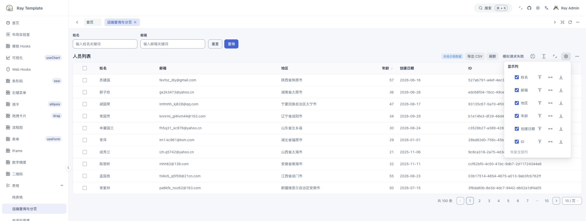

# Ray Template · Vue 3 Admin Dashboard Template

[简体中文](README.zh-CN.md) · **[Live demo](https://xiaodaigua-ray.github.io/ray-template/)** · **[Documentation](https://xiaodaigua-ray.github.io/ray-template/docs/)** · [Quick start](#quick-start)

Ray Template is an **open-source, ready-to-run frontend template** for admin dashboards, back-office tools, and internal apps. Run the demo to try a workspace with role-based menus and page tabs, then reuse TablePro list pages, workspace layouts, and route modules in your own app.

**Ray Template 6.0.0 starts a new major version.** It organizes Ray Admin, the documentation site, and reusable packages in one workspace. v6 does not offer an in-place upgrade from v5 or guarantee compatibility with v5 imports, APIs, deployment settings, or browser data. Existing projects can stay on [legacy/v5](https://github.com/XiaoDaiGua-Ray/ray-template/tree/legacy/v5), the final v5 main snapshot at `6f095b7` with manifest version `5.2.5`, or use the existing [v5.2.4 tag](https://github.com/XiaoDaiGua-Ray/ray-template/tree/v5.2.4).

[v6 architecture and adoption guide](apps/docs/guide/architecture.md) · [Version boundaries](apps/docs/migration.md)

**Stack**: Vue 3 · TypeScript / TSX · Naive UI · Vue Router · Pinia · Vue I18n · Vite / Rolldown · Axios · Vitest

[](https://xiaodaigua-ray.github.io/ray-template/)

Sign in with the prefilled form. Open **Tables → Remote search and pagination** to try the list shown above, or **Layout playground** to experiment with the workspace.

## Core features

### TablePro for simple tables and data-heavy pages

Use `RTablePro` with `bare` for a plain table, or add search, pagination, and a toolbar for a full list page. Column definitions, selection, sorting, and custom cells follow Naive UI DataTable.

- **Search and pagination**: Pass local `data` or a `request(params, signal)` function that returns `{ data, total }`. Remote queries accept only the latest result. A failed query keeps existing rows visible and lets users retry.
- **Long lists and column controls**: Fill the available workspace and use virtual scrolling for large lists. Users can show, hide, reorder, or pin columns. Set `columnStateKey` to remember hidden columns across reloads.
- **CSV and printing**: Export or print the current page's visible data columns by default. Point printing at a custom region for documents that need their own layout.

[TablePro API and data contract](packages/ui/src/RTablePro/README.md)

### A configurable workspace

Switch between sidebar, top, and mixed navigation. Narrow screens use a menu drawer. The workspace supports fixed or fluid width, a pinned header and footer, and a maximized content area. Pinia saves layout preferences. Try changes live in the layout playground or use named slots to replace the header, sidebar, tabs, and footer.

Page tabs keep multiple tasks open, and breadcrumbs show where you are. Find menu items with `⌘/Ctrl + K`, and switch between light and dark themes or English and Simplified Chinese.

[Layout playground source](apps/admin/src/views/demo/layout-demo.tsx) · [Layout configuration and slots](apps/admin/src/layout/README.md)

### HTTP route configuration connects pages, menus, and permissions

Register the page component ID in `apps/admin/src/router/config/views.ts`, then return its route record from the API to generate navigation and breadcrumbs. Initial demo records live in `apps/admin/src/mocks/data/routes.json`. Route metadata controls menu labels and icons, roles, visibility, and `keepAlive`. Detail pages can extend the breadcrumb while keeping the current menu and tab. Role checks cover both menu filtering and direct navigation. Connect your backend to validate sessions and authorize API requests.

[Routing guide](apps/admin/src/router/README.md) · [Nested navigation and caching example](apps/admin/src/mocks/data/routes.json)

### Reusable components, composables, and SVG icons

- **Components**: Start with `RForm` and `RModal` for forms and dialogs. `RChart` manages ECharts initialization, resizing, and theme changes. The demo also includes LogicFlow diagrams, barcodes, and draggable cards. [Component guide](apps/admin/src/components/README.md)
- **Composables**: Template hooks cover page refresh, content maximization, menu badges, and watermarks. Web hooks demonstrate screenshots, printing, and element fullscreen. The examples include expandable usage code. [Composables and examples](apps/admin/src/hooks/README.md)
- **SVG icons**: Add an SVG to a group under `packages/icons/src` to generate typed names and sprites. Routes and `RIcon` share names such as `navigation/dashboard`. The icon gallery lets you browse by group and copy TSX usage. [SVG icon workflow](packages/icons/src/A_README.md)

## Quick start

Use the pinned **Node.js 26.13.0** and **pnpm 12.16.1**. With nvm:

```sh
git clone https://github.com/XiaoDaiGua-Ray/ray-template.git
cd ray-template
nvm install
nvm use
npm install --global pnpm@12.16.1
pnpm install --frozen-lockfile
pnpm dev
```

Open [http://127.0.0.1:9527/ray-template/](http://127.0.0.1:9527/ray-template/) or use the URL printed by Vite. The prefilled demo sign-in and mock data let you run the template before connecting a backend.

Run `pnpm docs:dev` to develop the [documentation and interactive examples](apps/docs/README.md) from the same checkout.

## Project structure

```text
ray-template/
├── apps/
│   ├── admin/          # Ray Admin: pages, sessions, permissions, env and mocks
│   └── docs/           # VitePress: guides, API reference and live examples
├── packages/
│   ├── admin-shell/    # Layout, navigation, tabs, settings and transitions
│   ├── ui/             # TablePro, RBarcode, RChart and other shared components
│   ├── composables/    # Reusable Vue composables and browser helpers
│   ├── directives/     # Vue directives
│   ├── icons/          # SVG assets, icon names and manifest
│   ├── routing/        # Route schemas, validation and menu helpers
│   ├── http/           # HTTP clients, interceptors and request cancellation
│   └── utils/          # Precision, object and storage utilities
├── harness/            # Regression checks and local reports
└── pnpm-lock.yaml      # Shared workspace lockfile
```

Ray Admin starts in `apps/admin/src/main.ts`. Its `App.tsx` supplies theme, translations, icons, and column preference storage. Shared packages expose public entry points through `exports`. The documentation runs the same packages. The [TablePro demo](apps/docs/reference/table-pro.md) uses simulated requests to show cancellation and retry, while the [layout playground](apps/docs/guide/layout.md) runs with its own in-memory router.

See the [architecture map](docs/architecture.md) for how these modules work together.

## Build your first business page

This small people directory uses the template's mock query function. To adapt it for orders or inventory, replace the columns, search fields, and request function.

```tsx
import { getPersonList } from '@/api/demo/mock/person'
import { RTablePro } from '@ray-template/ui/table-pro'
import { defineComponent } from 'vue'

export default defineComponent({
  setup() {
    return () => (
      <RTablePro
        columns={[
          { title: 'Name', key: 'name' },
          { title: 'Email', key: 'email' },
        ]}
        request={getPersonList}
        search={[{ key: 'name', label: 'Name' }]}
        columnStateKey="demo:people"
      />
    )
  },
})
```

1. **Build the view.** Add a page in `apps/admin/src/views`. The [remote table example](apps/admin/src/views/demo/tables/remote.tsx) shows sorting, row selection, and toolbar actions.
2. **Connect navigation.** Register the page component ID and add its route to the Mock JSON or your backend response, with English and Simplified Chinese menu labels. Follow the [routing guide](apps/admin/src/router/README.md) when setting up page caching.
3. **Connect your data.** Define your API in `apps/admin/src/api`, use `apps/admin/src/axios` for interceptors and request cancellation, and connect your real sign-in and session. Development and static previews use the same HTTP Mock API. The [backend contract](apps/docs/guide/backend.md) includes authentication, permission codes, users, routes, and a generated OpenAPI specification. [Request layer guide](apps/admin/src/axios/README.md)

## Checks, builds, and deployment

| Command                       | What it does                                                                                |
| ----------------------------- | ------------------------------------------------------------------------------------------- |
| `pnpm test:run`               | Run the Vitest suite                                                                        |
| `pnpm check`                  | Run the same checks as CI, including types, lint, formatting, tests, and a production build |
| `pnpm harness context`        | Find entry points and checks for areas such as routing, UI, and APIs                        |
| `pnpm harness verify`         | Run the full check and save a local report, or pass a scope to run targeted checks          |
| `pnpm build` / `pnpm preview` | Build into `dist/production` or serve the build locally                                     |

`pnpm docs:build` builds the documentation separately. `pnpm pages:build` assembles both builds under `dist/pages` for `/ray-template/` and `/ray-template/docs/`.

Use the [architecture map](docs/architecture.md) to find module and configuration entry points. See the [deployment guide](docs/architecture.md#deployment-and-search-discovery) for root or subpath hosting and search metadata. Contributors and coding agents share the instructions in [AGENTS.md](AGENTS.md) and the [AI Harness](harness/README.md).

[MIT License](LICENSE) · [Changelog](CHANGELOG.md) · [Issues](https://github.com/XiaoDaiGua-Ray/ray-template/issues)

Use the [task index](llms.txt) to find the owning implementation, its consumers, and verification steps without installing dependencies. `pnpm harness context <scope>` shows the same index entry alongside the commands it runs.
