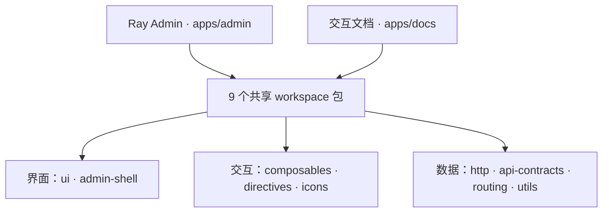

# Ray Template

**四种视觉风格，五种导航布局，把中后台做得顺手，也做得好看。**

[English](README.md) · **[在线演示](https://xiaodaigua-ray.github.io/ray-template/)** · **[在线文档](https://xiaodaigua-ray.github.io/ray-template/docs/)** · [快速开始](#快速开始) · [架构设计](#monorepo-架构)

Ray Template 是基于 Vue 3、TypeScript / TSX 和 Naive UI 的开源中后台模板，适合管理后台、运营工作台和内部工具。完整应用、共享包和交互文档放在同一工作区，克隆即可运行，再按业务调整界面、页面和接口。

**4 种视觉风格 · 5 种导航布局 · 11 个 TablePro 示例 · 9 个共享包**

[](https://xiaodaigua-ray.github.io/ray-template/#/dashboard)

[](https://xiaodaigua-ray.github.io/ray-template/#/tables/auto-height)

_欢迎页与 TablePro · 默认 Modern 风格 · 浅色主题。_

## 风格与布局

### 四种风格，覆盖整套界面

| 风格                | 视觉特点                                       |
| ------------------- | ---------------------------------------------- |
| **Modern · 现代化** | 蓝色主调、适度留白与柔和圆角，作为默认工作台。 |
| **Naive UI · 原生** | 保留组件库的原生控件、比例与绿色主调。         |
| **Material**        | 带色阶的面板、更大的圆角与胶囊按钮。           |
| **Plain · 朴素**    | 中性色、小圆角与平面化界面。                   |

风格会应用到布局外壳、控件、表格与图表主题。每种风格都支持浅色和深色，可以手动选择或跟随系统；主题色可以自定义，偏好配置支持 JSON 导入与导出。


[](https://xiaodaigua-ray.github.io/ray-template/#/tables/auto-height)

_相同的欢迎页与 TablePro，切换至 Modern 深色主题。_

### 五种导航，适配不同工作方式

**侧边导航 · 顶部导航 · 混合导航 · 右侧导航 · 通栏分组**

菜单可以放在左侧、顶部或右侧，也可以将一级分组与子菜单分开。工作区支持流式铺满、定宽居中、间距调整和顶栏／页脚固定，窄屏自动使用菜单抽屉。

多标签页、KeepAlive、面包屑、`⌘/Ctrl + K` 全局搜索、内容最大化和页面动效均已接入，提供中英文切换。布局、外观和菜单偏好即时生效，并保存在当前浏览器。

[主题与样式变量](apps/docs/guide/appearance.md) · [布局实验室](apps/docs/guide/layout.md) · [外壳接入](apps/admin/src/layout/README.md)

## TablePro：从展示数据到处理业务

同一个 `RTablePro`，可以用于纯表格、可查询的管理列表，也可以承载密集的运营页面。列定义与自定义单元格沿用 Naive UI DataTable 的方式。

- **搜索随业务扩展**：文本、数字、多选、日期、树选择、级联和自定义字段，支持校验、远程候选联动、手动提交与防抖自动提交。
- **本地与远端共用入口**：本地筛选、组件管理请求或页面控制分页；远端查询只采用最新结果，并透传取消信号。
- **充分利用工作区**：自适应高度、虚拟滚动、列显隐、顺序调整、固定和列偏好存储。
- **常用操作直接可用**：复制表格为 PNG、导出 CSV、打印表格或自定义区域，以及行菜单和工具栏扩展。
- **页面可以主动控制**：通过 `useTablePro` 操作搜索、分页，读取当前页数据与请求状态；行选择由页面维护受控的行键。

请求失败时清空失败结果并提示错误，可以重新查询或刷新。示例同时覆盖成功、取消和失败恢复过程。

[11 个在线示例](https://xiaodaigua-ray.github.io/ray-template/docs/reference/table-pro-examples.html)包含高级搜索、受控分页、列设置、打印和实例 Hooks，每个场景都附上实际运行的源码。

[TablePro API](apps/docs/reference/table-pro.md) · [组件契约](packages/ui/src/RTablePro/README.md) · [第一个业务页面](apps/docs/guide/first-page.md)

## 带着完整应用开始

| 能力           | 已有内容                                                                      |
| -------------- | ----------------------------------------------------------------------------- |
| **用户与组织** | 组织树、成员查询、新增／编辑／详情、账号状态、角色和权限控制的操作。          |
| **路由与权限** | 可视化和 JSON 路由编辑器、菜单生成、角色导航、直接访问守卫与页面缓存。        |
| **表单与弹窗** | `RForm`、`useForm`、`RModal`，配套校验、重置、加载状态与交互示例。            |
| **图表与交互** | ECharts 实例和主题管理、LogicFlow、拖拽卡片、右键菜单、截图、打印和全屏。     |
| **图标与工具** | 带类型提示的 SVG 名称与精灵图、二维码、条形码、精度运算、存储、Hooks 和指令。 |
| **交互文档**   | 指南、API 参考和可运行示例，与后台应用使用同一工作区的组件。                  |

开发环境和静态在线演示共用 **MSW HTTP Mock**，登录、用户、路由和示例数据都经过 API 层。接入后端时配置 `VITE_API_BASE_URL` 与 `VITE_API_MOCK=false`，共享 Schema 和自动生成的 **OpenAPI 3.1** 提供接口契约；真实会话与接口授权由业务后端负责。

[后端接入](apps/docs/guide/backend.md) · [路由与菜单](apps/admin/src/router/README.md) · [组件参考](apps/docs/reference/components.md) · [Hooks 参考](apps/docs/reference/hooks.md)

## Monorepo 架构

Ray Admin 与文档站采用 **pnpm Monorepo**。业务接入留在应用层，可复用能力通过共享包的明确入口提供。



- **[apps/admin](apps/admin)**：页面、会话、Pinia、路由注册、业务 API 和 Mock。
- **[apps/docs](apps/docs)**：运行共享组件，并嵌入同一次构建中的后台示例。
- **[packages](packages)**：通过公开 `exports` 提供入口，边界检查覆盖导入、依赖声明与循环依赖。目前作为工作区包使用，未单独发布到 npm。

主题使用语义化变量，让自定义页面跟随风格、明暗模式和主题色。布局外壳提供运行时尺寸变量，以及顶栏、侧栏、标签、页脚和内容插槽。

[架构地图](docs/architecture.md) · [接口契约包](packages/api-contracts/README.md) · [自定义样式约定](docs/ui-design.md#custom-css-contract)

## 快速开始

使用仓库固定的 **Node.js 26.13.0** 和 **pnpm 12.16.1**。

```sh
git clone https://github.com/XiaoDaiGua-Ray/ray-template.git
cd ray-template
nvm install
nvm use
npm install --global pnpm@12.16.1
pnpm install --frozen-lockfile
pnpm dev
```

打开 [http://127.0.0.1:9527/ray-template/](http://127.0.0.1:9527/ray-template/)，点击 **使用演示账号进入**。登录页还提供管理者和只读账号，无需先搭建业务后端。

1. **先体验界面**：在「设置」中切换风格与布局，再查看用户管理和 TablePro。
2. **写第一个页面**：参考[现有示例](apps/admin/src/views/demo)，登记页面组件 ID，添加路由及中英文菜单文案。
3. **接入业务接口**：保留页面契约，按[后端接入指南](apps/docs/guide/backend.md)连接自己的服务。

## 开发与交付

**Vue 3 · TypeScript / TSX · Naive UI · Vite / Rolldown · Pinia · Vue Router · Vue I18n · Axios · MSW · Vitest**

| 命令                           | 用途                                                             |
| ------------------------------ | ---------------------------------------------------------------- |
| `pnpm dev` / `pnpm docs:dev`   | 开发后台应用或文档站。                                           |
| `pnpm build` / `pnpm preview`  | 构建或预览后台应用。                                             |
| `pnpm pages:build`             | 将后台与文档组装到 `dist/pages`。                                |
| `pnpm harness context <scope>` | 查找实现入口、契约与相关检查。                                   |
| `pnpm harness verify <scope>`  | 执行对应任务域的检查并保存报告。                                 |
| `pnpm check`                   | 检查环境、契约、包边界、类型、Lint、格式、测试和两个站点的构建。 |

CI 配置覆盖 **Linux、Windows 和 macOS**。[任务索引](llms.txt)与 [AI Harness](harness/README.md) 为维护者和编码智能体提供可导航的工程上下文。

默认部署路径为后台 `/ray-template/`、文档 `/ray-template/docs/`。修改 base 前请阅读[部署约定](docs/architecture.md#deployment-and-search-discovery)。

## 版本边界

**v6 启用 Monorepo 架构。** 不提供 v5 原地升级，也不保证兼容 v5 的内部导入、接口、部署配置或浏览器数据。

已有项目可以继续使用 [legacy/v5](https://github.com/XiaoDaiGua-Ray/ray-template/tree/legacy/v5)（最后的 v5 主线快照 `6f095b7`，清单版本 `5.2.5`），或使用对应的 [v5.2.5 标签](https://github.com/XiaoDaiGua-Ray/ray-template/tree/v5.2.5)。采用 v6 前请先阅读[迁移说明](apps/docs/migration.md)。

---

[MIT License](LICENSE) · [更新记录](CHANGELOG.md) · [反馈问题](https://github.com/XiaoDaiGua-Ray/ray-template/issues) · [贡献约定](AGENTS.md)
