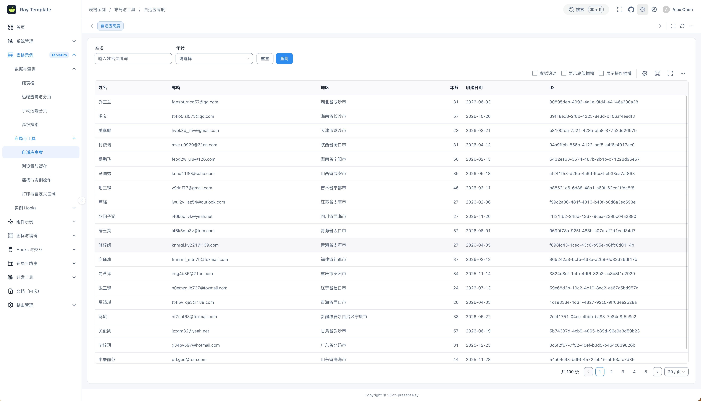
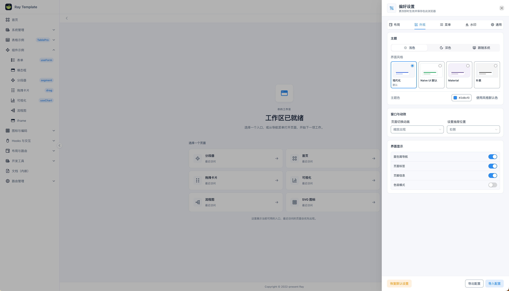
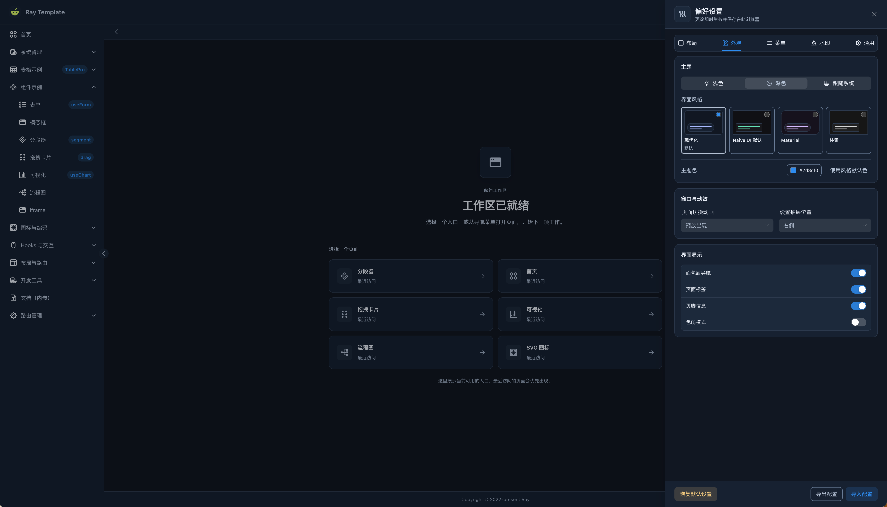
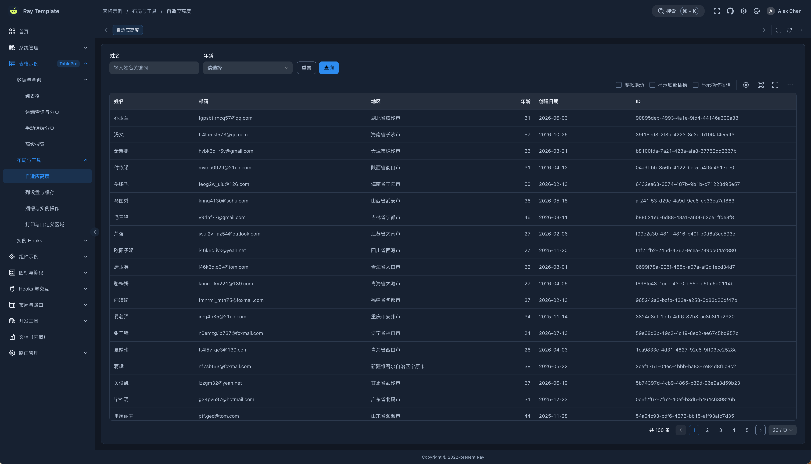

# Ray Template

**面向 AI 协作开发的 Vue 3 中后台模板。**

让开发者与编码助手沿着同一条路径工作：**找到实现入口，理解模块契约，复用现有能力，验证实际改动。**

[English](README.md) · **[在线演示](https://xiaodaigua-ray.github.io/ray-template/)** · **[在线文档](https://xiaodaigua-ray.github.io/ray-template/docs/)** · [快速开始](#快速开始) · [与 AI 一起开发](#与-ai-一起开发)

Ray Template 基于 Vue 3、TypeScript / TSX 和 Naive UI，适合管理后台、运营工作台与内部工具。仓库同时提供可运行的应用、共享组件、交互文档，以及按任务组织的工程上下文。

**任务索引与验证入口 · 4 种完整视觉风格 · 5 种导航布局 · 11 个 TablePro 示例**

[](https://xiaodaigua-ray.github.io/ray-template/#/tables/auto-height)

## 为什么选择 Ray Template

### 为 AI 协作准备的工程上下文

[AGENTS.md](AGENTS.md) 说明协作约定，[llms.txt](llms.txt) 按任务导航到源码、契约、示例和检查入口。处理表格、路由、布局或接口问题时，可以按范围读取相关上下文，并通过 Harness 执行对应检查、保存结果。

### 应用、文档与示例共用源码

后台与文档站消费同一工作区的共享包。交互示例使用真实组件，TablePro 文档引用实际运行的示例源码；修改公共能力时，应用与文档都能参与验证。[查看示例](apps/docs/reference/table-pro-examples.md) · [文档协作约定](docs/docs-handoff.md)

### 四种风格覆盖业务界面

Modern、Naive UI、Material、Plain 覆盖布局外壳、控件、表格和图表，并分别提供明暗模式。自定义页面通过语义化主题变量继承颜色、圆角与阴影，通过运行时布局变量适应工作区尺寸。[主题接入](apps/docs/guide/appearance.md) · [样式契约](docs/ui-design.md#custom-css-contract)

### TablePro 兼顾交互与数据状态

一个表格入口支持本地数据、远程请求和受控分页，并配套高级搜索、列设置、导出、打印与实例 Hooks。请求竞态、取消信号、失败恢复和导出范围都有明确契约与对应回归用例。[11 个在线示例](https://xiaodaigua-ray.github.io/ray-template/docs/reference/table-pro-examples.html) · [组件契约](packages/ui/src/RTablePro/README.md)

### 从静态演示到业务 API，沿用同一套契约

开发环境与静态在线演示共用 MSW HTTP Mock，页面通过真实的 API 调用链获取数据。共享 TypeScript 类型、Valibot Schema 与生成的 OpenAPI 3.1 为后端接入提供依据，契约同步由命令检查。[接口契约](packages/api-contracts/README.md) · [后端接入](apps/docs/guide/backend.md)

### 路由配置既能可视化编辑，也有可校验的契约

通过可视化编辑器或 JSON 管理菜单顺序、角色、可见性与缓存，结合树预览、导入导出、JSON Schema 和可用页面 ID 维护配置。配置最终落到同一套路由模型，接入约束与权限边界有专门说明。[路由与菜单](apps/admin/src/router/README.md)

<!-- fullstack:start -->

### 同一工程，按需要选择前端或全栈源码

可以导出独立运行的纯前端源码，也可以保留 NestJS、PostgreSQL 与 Redis 的全栈实现。发行脚本按依赖图裁剪工作区、锁文件和专属说明，并记录版本、来源提交与内容摘要。[发行版本与启动方式](apps/docs/guide/distributions.md)

<!-- fullstack:end -->

## 快速开始

使用仓库固定的 **Node.js 26.13.0** 和 **pnpm 12.16.1**。

```sh
git clone https://github.com/XiaoDaiGua-Ray/ray-template.git
cd ray-template
nvm install
nvm use
npm install --global pnpm@12.16.1
pnpm install --frozen-lockfile
pnpm dev
```

打开 [http://127.0.0.1:9527/ray-template/](http://127.0.0.1:9527/ray-template/)，点击 **使用演示账号进入**。还可以切换管理者与只读账号，体验权限差异；前端演示无需数据库或业务后端。

- **先看界面**：在「设置」中切换风格与布局，再体验用户管理和 TablePro。
- **开始写业务**：参考[第一个业务页面](apps/docs/guide/first-page.md)，复用组件并登记路由与中英文菜单。
- **接入自己的服务**：按[后端接入指南](apps/docs/guide/backend.md)配置 `VITE_API_BASE_URL` 和 `VITE_API_MOCK=false`。

## 与 AI 一起开发

AI 友好体现在日常开发路径中。能够读取仓库并执行命令的编码助手，可以和维护者使用相同的 Markdown 文档、源码入口与验证命令。

| 开发时需要回答的问题                   | 工程中的依据                                                                                                                                                       |
| -------------------------------------- | ------------------------------------------------------------------------------------------------------------------------------------------------------------------ |
| 从哪里开始，遵守哪些约定？             | [AGENTS.md](AGENTS.md)：改动范围、复用、文档同步与验收约定。                                                                                                       |
| 这项任务要读哪些文件？                 | [llms.txt](llms.txt) → [任务索引](harness/context)：实现、调用方、契约和测试入口。                                                                                 |
| 哪个模块负责，哪些边界不能跨？         | [架构地图](docs/architecture.md)、公共 `exports` 与[包边界检查](scripts/check-package-boundaries.mjs)。                                                            |
| 已有能力怎么用，参数和状态有什么约束？ | [组件参考](apps/docs/reference/components.md)、[Hooks 参考](apps/docs/reference/hooks.md)、模块 README 与[可运行示例](apps/docs/reference/table-pro-examples.md)。 |
| 接口形状、Mock 与业务请求如何对齐？    | [共享 Schema 与 OpenAPI](packages/api-contracts/README.md)，通过 `pnpm api:check` 检查生成文件同步。                                                               |
| 改完应该跑什么，实际结果在哪里？       | [验证范围](harness/scopes.json)、`pnpm harness verify <scope>`，结果保存在 `.harness-local/runs/`。                                                                |

例如，处理 TablePro 时先查看任务上下文，再按改动范围验证：

```sh
pnpm harness context table-pro
pnpm harness verify table-pro
```

也可以把下面的需求交给编码助手，替换其中的业务内容：

```text
请先读取 AGENTS.md 和 llms.txt，定位这项任务对应的上下文。
新增一个项目列表页，包含名称、状态和负责人筛选，支持远程分页。
先检查现有 TablePro 示例、路由注册、接口契约与中英文文案，复用已有能力。
说明需要修改的模块后完成实现，执行相关检查；可见交互需要浏览器验证。
交付时列出改动、实际通过的检查和仍未验证的部分。
```

`llms.txt` 在这里是仓库任务索引，可显式交给助手阅读。上下文按任务读取，具体行为以当前源码和契约为准。Harness 只执行所选范围注册的命令；类型、Lint、格式与浏览器检查按改动补充，完整检查使用 `pnpm check`。详见[验证规则](harness/README.md#choosing-the-verification-scope)。

## 中后台常用能力

| 能力             | 已有内容                                                                                                                  |
| ---------------- | ------------------------------------------------------------------------------------------------------------------------- |
| **用户与账号**   | 登录、退出、会话恢复与锁屏；组织树、成员查询、新增／编辑／详情、账号状态、角色、个人资料与密码表单。                      |
| **路由与权限**   | 可视化和 JSON 路由编辑、菜单生成、角色导航、操作权限、直接访问守卫与 KeepAlive。                                          |
| **导航与工作区** | 多标签页、右键操作、面包屑、`⌘/Ctrl + K` 搜索、按账号隔离的最近访问与收藏、内容最大化、页面动效与 403／404／500 页面。    |
| **表格与搜索**   | 本地／远程／受控分页，高级搜索与远程候选联动，自适应高度、虚拟滚动、列显隐偏好存储、列顺序调整与固定。                    |
| **表单与弹窗**   | `RForm`、`useForm`、`RModal`，支持校验、重置、加载状态与交互示例。                                                        |
| **可视化与交互** | ECharts 生命周期和主题管理、LogicFlow、拖拽卡片、右键菜单、截图、CSV 导出、打印与全屏。                                   |
| **主题与国际化** | 四种风格、明暗与系统模式、自定义主题色、中英文文案、偏好即时保存及 JSON 导入／导出。                                      |
| **图标与工具**   | 带类型提示的 SVG 名称与生成精灵图，二维码、条形码、精度运算、存储、组合式函数与指令。                                     |
| **工程与集成**   | pnpm 工作区、请求取消、类型与包边界检查、Vitest、ESLint / Prettier，以及 [Wujie 子应用启动入口](apps/admin/src/main.ts)。 |

前端权限用于控制页面体验，真实会话与 API 授权由业务后端验证。演示数据的用途和接入边界见[后端接入指南](apps/docs/guide/backend.md)。

## 风格与布局

| 风格                | 视觉特点                                 |
| ------------------- | ---------------------------------------- |
| **Modern · 现代化** | 默认风格，蓝色主调、适度留白与柔和圆角。 |
| **Naive UI · 原生** | 保留组件库原生控件、比例与绿色主调。     |
| **Material**        | 带色阶的面板、大圆角与胶囊按钮。         |
| **Plain · 朴素**    | 中性色、小圆角与平面化界面。             |

**侧边导航 · 顶部导航 · 混合导航 · 右侧导航 · 通栏分组**。支持流式或定宽内容、间距调整、固定顶栏／页脚，窄屏使用菜单抽屉。可以在[在线演示](https://xiaodaigua-ray.github.io/ray-template/)中直接切换，或查看[布局实验室](apps/docs/guide/layout.md)。

<details>
<summary>查看工作台与深色主题预览</summary>





[](https://xiaodaigua-ray.github.io/ray-template/#/tables/auto-height)

</details>

## 工作区与源码发行

采用 **pnpm Monorepo**，业务接入与共享能力分别维护。

| 位置                         | 职责                                                                                                                               |
| ---------------------------- | ---------------------------------------------------------------------------------------------------------------------------------- |
| [apps/admin](apps/admin)     | 页面、会话、Pinia、路由注册、业务 API 与 Mock。                                                                                    |
| [apps/docs](apps/docs)       | VitePress 指南、API 参考与交互示例。                                                                                               |
| [packages](packages)         | 10 个共享包：`ui`、`admin-shell`、`composables`、`directives`、`icons`、`http`、`api-contracts`、`demo-data`、`routing`、`utils`。 |
| [harness](harness/README.md) | 任务上下文、验证范围、检查命令与结果报告。                                                                                         |

共享包通过公开 `exports` 提供能力，边界检查覆盖导入、依赖声明、运行环境与循环依赖。包随工作区使用，未单独发布到 npm。[查看架构地图](docs/architecture.md)

**纯前端源码**：执行 `pnpm dist:frontend`，在 `dist/distributions/` 生成 `ray-template-frontend-<version>.tar.gz` 及源码目录。解压后运行 `pnpm install --frozen-lockfile` 和 `pnpm dev`。导出包含 Admin、文档、共享包与 Mock，排除本地配置、凭据、构建结果和已安装依赖。`distribution.json` 记录版本、来源提交、工作区状态与内容摘要。

<!-- fullstack:start -->

**可选全栈源码**：完整仓库还包含 [apps/server](apps/server)，使用 NestJS、PostgreSQL 与 Redis，实现会话、API 权限、用户、路由配置、审计与限流。执行 `pnpm dist:fullstack` 导出同版本全栈源码。

安装依赖并准备 Docker Compose 后，运行：

```sh
pnpm fullstack:setup
pnpm dev:full
```

`setup` 创建私有 `apps/server/.env.local`，启动 PostgreSQL 与 Redis，迁移并初始化管理员。随机生成的管理员密码保存在该文件中；真实后端不接受 Mock 演示密码。已有数据库和 Redis 时使用 `pnpm fullstack:setup --external`，配置方式见[启动指南](apps/docs/guide/distributions.md)。

也可以运行 `node scripts/fullstack.mjs up`，由 Docker 构建并启动整套服务，宿主机无需预先安装项目依赖，默认入口为 `http://127.0.0.1:8080/ray-template/`。`pnpm fullstack:stop` 停止服务并保留数据卷。

[源码发行工作流](.github/workflows/distributions.yaml)提供归档验证、生成 `frontend` 分支和附加已有 Release 资产的手动选项。[容器启动与发布说明](apps/docs/guide/distributions.md#容器启动)

<!-- fullstack:end -->

## 开发与验证

**Vue 3 · TypeScript / TSX · Naive UI · Vite / Rolldown · Pinia · Vue Router · Vue I18n · Axios · MSW · Vitest**

| 命令                           | 用途                                                                                                 |
| ------------------------------ | ---------------------------------------------------------------------------------------------------- |
| `pnpm dev` / `pnpm docs:dev`   | 开发后台或文档站。                                                                                   |
| `pnpm build` / `pnpm preview`  | 构建或预览后台。                                                                                     |
| `pnpm pages:build`             | 将后台与文档组装到 `dist/pages`。                                                                    |
| `pnpm harness context <scope>` | 读取任务入口与相关检查命令。                                                                         |
| `pnpm harness verify <scope>`  | 执行选定范围的检查并保存报告。                                                                       |
| `pnpm harness check`           | 检查任务索引、相对文件链接与验证范围注册。                                                           |
| `pnpm check`                   | 执行当前源码版本配置的完整检查，包括环境、契约、包边界、类型、Lint、格式、测试、站点构建与发行计划。 |

<!-- fullstack:start -->

完整仓库的 `pnpm check` 还包含服务端类型、测试与构建。发行计划检查验证导出结构与依赖，独立安装、运行和部署环境仍需对应验收。

<!-- fullstack:end -->

CI 配置覆盖 **Linux、Windows 与 macOS**。贡献前阅读 [AGENTS.md](AGENTS.md) 与 [Harness 验证说明](harness/README.md)。默认部署路径为后台 `/ray-template/`、文档 `/ray-template/docs/`，修改前请查看[部署约定](docs/architecture.md#deployment-and-search-discovery)。

## 版本边界

**v6 启用 Monorepo 架构，不提供 v5 原地升级。** v5 的内部导入、接口、部署配置和浏览器数据不保证兼容。

已有项目可以继续使用 [legacy/v5](https://github.com/XiaoDaiGua-Ray/ray-template/tree/legacy/v5) 或 [v5.2.5 标签](https://github.com/XiaoDaiGua-Ray/ray-template/tree/v5.2.5)。采用 v6 前请阅读[迁移说明](apps/docs/migration.md)。

---

[MIT License](LICENSE) · [更新记录](CHANGELOG.md) · [反馈问题](https://github.com/XiaoDaiGua-Ray/ray-template/issues) · [贡献约定](AGENTS.md)
